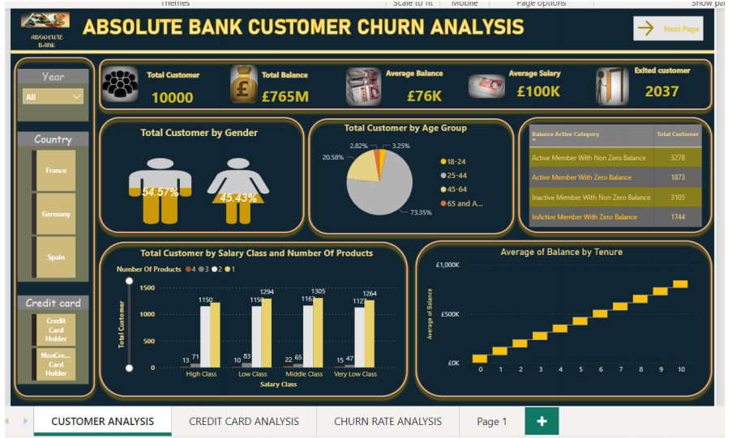
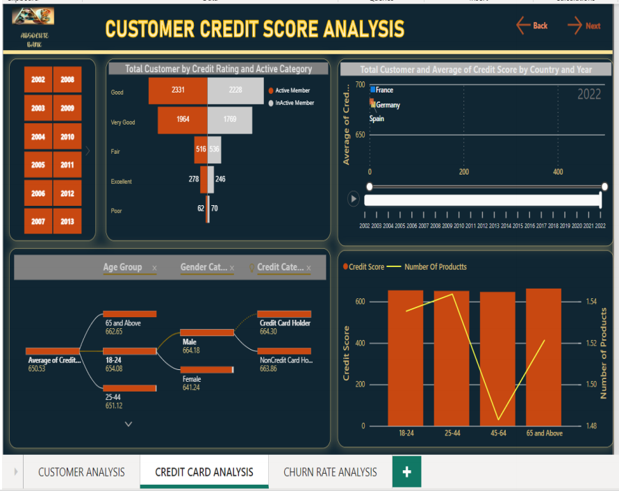
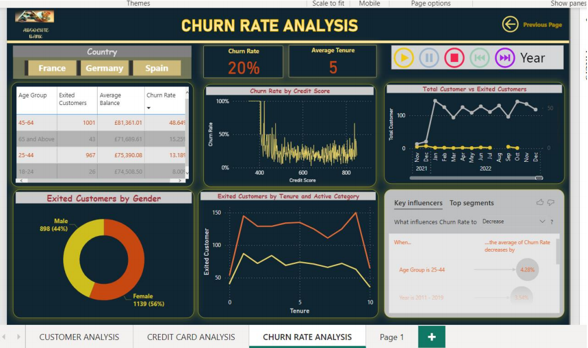

# Bank Customer Churn Analysis

## Project Overview

This project explores customer churn in a retail banking dataset using Microsoft Power BI.

The aim was to examine customer characteristics, identify patterns associated with customer churn, and present the findings through an interactive dashboard.

## Business Problem

Customer churn is an important issue for banks because losing customers can affect revenue and long-term business growth.

This analysis explores:

- How many customers left the bank.
- Which customer groups had higher observed churn rates.
- Whether customer activity, age, geography and product usage showed patterns associated with churn.
- How the findings could support customer retention decisions.

## Dataset

The analysis uses the Bank Customer Churn Modelling dataset.

- **Number of records:** 10,000 customers
- **Number of columns:** 14
- **Target variable:** Exited
- **Analysis tool:** Microsoft Power BI

## Tools and Technologies

- Microsoft Power BI
- Power Query
- DAX
- Data cleaning and transformation
- Data modelling and visualisation
- CSV dataset

## Data Preparation

The dataset was reviewed and prepared using Power Query.

The preparation process included:

- Reviewing the dataset structure and data types.
- Removing unnecessary fields, including RowNumber.
- Renaming fields for clarity.
- Checking data quality and column distributions.
- Applying appropriate data types.
- Preparing the data for analysis and visualisation.

## Dashboard

The Power BI dashboard presents different views of customer behaviour and churn.

The main analysis areas include:

- Customer analysis
- Credit card analysis
- Churn rate analysis

### Dashboard Screenshots

**Dashboard Overview**

**Customer Analysis**

**Churn Analysis**

## Key Findings

The analysis identified several patterns:

- **Overall churn:** 2,037 out of 10,000 customers had exited the bank, representing 20.37%.
- **Age:** Customers aged 45–64 showed a substantially higher observed churn rate than younger customer groups.
- **Geography:** Germany had a higher observed churn rate (32.44%) than France (16.15%) and Spain (16.67%).
- **Gender:** Female customers had a higher observed churn rate (25.07%) than male customers (16.46%).
- **Activity:** Inactive customers had a higher observed churn rate than active customers.

These findings describe patterns in the dataset and should not be interpreted as proof of causation.

## Business Interpretation

The findings suggest that customer retention analysis could benefit from closer attention to:

- Older customer groups.
- Customers in geographical areas with higher observed churn.
- Inactive customers.
- Differences in product usage and customer engagement.

Further investigation would be needed before implementing retention strategies.

## Data Limitations

- The dataset represents a sample of banking customers and may not reflect the behaviour of all bank customers.
- The analysis identifies associations, not causal relationships.
- Some date-related fields in the original academic analysis were generated during data preparation. They should not be treated as evidence of genuine historical or seasonal churn patterns.
- Smaller customer groups may produce less reliable comparisons.

## Skills Demonstrated

- Data preparation and transformation.
- Exploratory data analysis.
- Power BI dashboard development.
- Data visualisation.
- Business insight generation.
- Analytical interpretation and communication.

## Future Improvements

- Develop additional DAX measures for deeper analysis.
- Improve the dashboard layout and user experience.
- Investigate customer lifetime value and potential revenue impact.
- Explore predictive modelling to identify customers at risk of leaving.
- Validate findings using additional banking datasets.

## Project Files

| Folder | Contents |
|---|---|
| `data/` | Customer churn dataset |
| `powerbi/` | Power BI dashboard |
| `screenshots/` | Dashboard screenshots |

